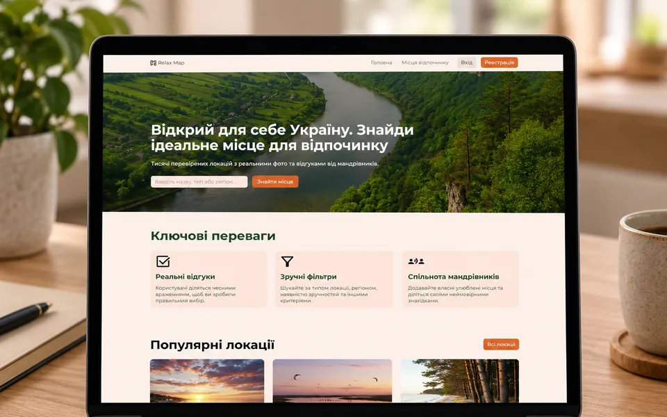
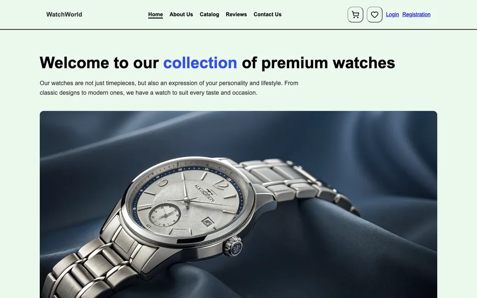
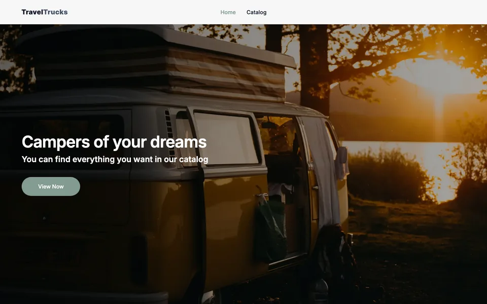
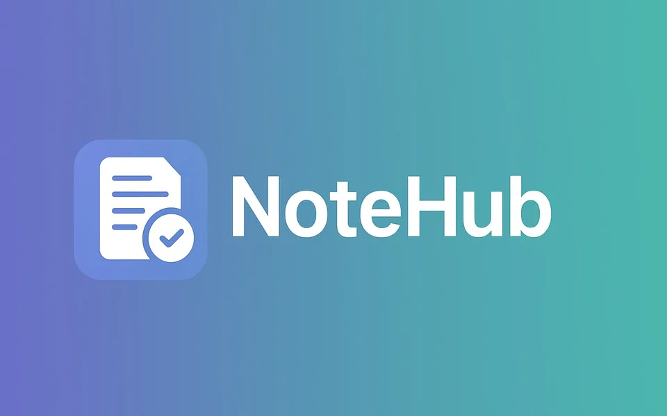
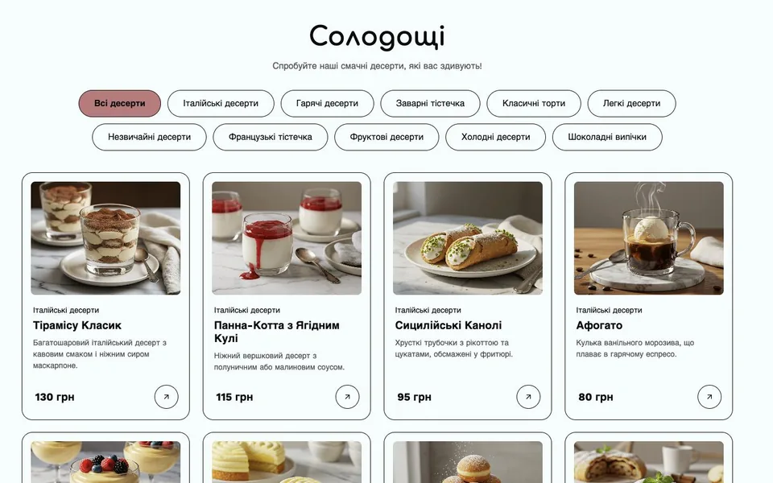

<picture>
  <source media="(prefers-color-scheme: dark)" srcset="assets/header-dark.svg">
  
</picture>

## 💻 Frontend

## ⚙️ Backend

## 🛠️ Tools & DevOps 

## 🚀 Projects

| Project | What it is | Stack | Links |
| :-- | :-- | :-- | :-- |
| <h3><a href="https://final-team-project-fs.vercel.app/">DiscoveryUA</a></h3> | Nature-spot catalogue for Ukraine. Team of 12, I owned the user-profile feature end to end. | Next.js · TypeScript · TanStack Query · Express · MongoDB |   |
| <h3><a href="https://watch-world-pykp.onrender.com/">WatchWorld</a></h3> | Full-stack watch store with bcrypt auth, sessions, role-based admin panel, basket and search. Solo. | Node.js · Express · SQLite · EJS |   |
| <h3><a href="https://travel-trucks-eight-iota.vercel.app/">TravelTrucks</a></h3> | Camper-rental app with server-side filters, "Load more" pagination and a validated booking form. Solo. | Next.js · TypeScript · TanStack Query · Formik · Yup |   |
| <h3><a href="https://09-auth-nine-gilt.vercel.app/">NoteHub</a></h3> | Notes app with sign-up, login, cookie sessions and full CRUD. Solo. | Next.js · TypeScript · TanStack Query · Axios · REST API |   |
| <h3><a href="https://dima-dev1.github.io/Sweet-Workshop-Project/">Sweet Workshop</a></h3> | Dessert store. Team lead of 8: ran the Git workflow, reviewed and merged every PR. | JavaScript · Vite · REST API · Figma |   |

